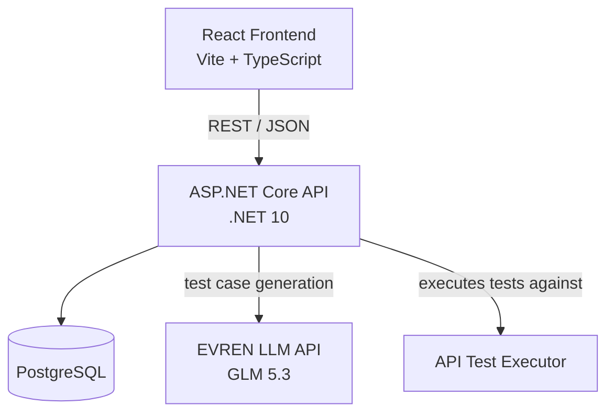
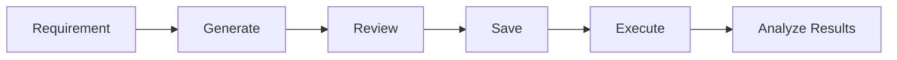

# AITestHub

**AI-powered API test generation, management and automated execution platform.**


AITestHub turns a plain requirement into executable REST API test cases using the
**EVREN LLM API (GLM 5.3)**, stores them per project in PostgreSQL, executes them
against real HTTP endpoints with status-code assertions, and tracks results, pass
rates and execution history — with a React dashboard on top.

## Overview

- **Generate** — the AI writes professional test cases (preconditions, steps, expected result, priority, type) from your requirement
- **Review & Save** — generated tests are previewed and selected in the UI before anything is persisted
- **Execute** — the backend runs each test against the target API (SSRF-protected) and asserts the expected status code
- **Analyze** — statuses, pass rates and full execution history per test case and project

## Key Features

- Project & test case management (CRUD, priority, type, status, execution notes)
- AI generation of manual **and** executable API test cases (GLM 5.3 / EVREN)
- Review & save workflow — generate never persists
- Automated execution: single, batch and per-project
- Pass/fail assertion with duration, error message and execution history
- Dashboard (React + TypeScript + Vite) with summary cards and filters
- SSRF protection: private/localhost/metadata IP blocking, DNS checks, redirects disabled
- Docker: `docker compose up --build` brings up the full stack

## Architecture



## Workflow



## Demo Scenario

1. **Create a project** (e.g. "Public API Demo") from the Projects page
2. **Enter a public API target** — e.g. base URL `https://jsonplaceholder.typicode.com`, endpoint `/posts`, method `POST` (no credentials required)
3. **Generate** executable test cases with GLM 5.3 from a short requirement
4. **Review / select** the generated tests in the preview
5. **Save** the selected tests
6. **Execute** a single test or the whole project
7. **Inspect** the dashboard summary and the execution history of each test

## Screenshots

Screenshots are not included yet. Add the following files under
`docs/screenshots/` (see `docs/screenshots/README.txt`) and uncomment the
references below:

- `dashboard.png` — main dashboard with summary cards and pass rate
- `ai-generation.png` — AI generation page with preview and selection
- `test-results.png` — project detail with test results and history

<!-- 


-->

## Tech Stack

| Layer | Technology |
|---|---|
| Backend | .NET 10, ASP.NET Core Web API, EF Core |
| Database | PostgreSQL |
| AI | EVREN LLM API (GLM 5.3) |
| Frontend | React, TypeScript, Vite, React Router |
| Tests | xUnit (backend), Vitest (frontend) |
| Deployment | Docker, Docker Compose, nginx |

## Quick Start with Docker

```bash
cp .env.example .env
# edit .env: set POSTGRES_PASSWORD and EVREN_API_KEY

docker compose up --build
```

- Frontend: `http://localhost:5173`
- Backend API: `http://localhost:5098` (Swagger at `/swagger`)

**Migrations (Docker):** the backend applies pending EF Core migrations at
startup (flag `ApplyMigrationsAtStartup=true` in the compose file). It waits for
PostgreSQL to become healthy, retries briefly if the database is unavailable,
and only applies **additive** migrations — it never drops or recreates anything.
Prefer manual control? Remove the flag and run `dotnet ef database update`
against the exposed PostgreSQL port (default host port 5433).

## Local Development

### Backend

```bash
# Secret configuration (once): store the DB connection string in user secrets
dotnet user-secrets set "ConnectionStrings:DefaultConnection" "Host=localhost;Port=5432;Database=aitesthub_dev;Username=postgres;Password=<your-password>"

# EVREN API key as an environment variable (never in files):
$env:Evren__ApiKey = "<your-key>"

dotnet ef database update
dotnet run
```

The API listens on `http://localhost:5098`. Alternatively, the connection string
can be overridden with the `ConnectionStrings__DefaultConnection` environment
variable.

### Frontend

```bash
cd AITestHub.Web
npm install
npm run dev
```

Dev server: `http://localhost:5173` (backend URL via `VITE_API_BASE_URL`,
see `AITestHub.Web/.env.example`).

## Environment Variables

| Variable | Where | Description |
|---|---|---|
| `Evren__ApiKey` | backend | EVREN API key (secret, server-side only) |
| `ConnectionStrings__DefaultConnection` | backend / user secrets | PostgreSQL connection string |
| `Cors__AllowedOrigins` | backend | Comma-separated allowed frontend origins |
| `ApplyMigrationsAtStartup` | backend | `true` to apply migrations on boot (Docker) |
| `POSTGRES_DB` / `POSTGRES_USER` / `POSTGRES_PASSWORD` | compose | Database credentials |
| `POSTGRES_PORT` | compose | Host port for PostgreSQL (default 5433) |
| `BACKEND_PORT` / `FRONTEND_PORT` | compose | Host ports for backend/frontend |
| `EVREN_API_KEY` | compose | Passed to the backend as `Evren__ApiKey` |
| `VITE_API_BASE_URL` | frontend build | Public backend URL as seen from the browser |

## API Overview

| Area | Endpoint | Description |
|---|---|---|
| Projects | `GET/POST /api/projects`, `GET/PUT/DELETE /api/projects/{id}` | Project CRUD |
| Project summary | `GET /api/projects/{id}/test-summary` | Status counts + pass rate |
| AI generate (manual) | `POST /api/aitestcases/generate` → `/save` | Generate manual test cases, then save |
| AI generate (executable) | `POST /api/aitestcases/generate-api` | Generate executable API tests (not persisted) |
| AI save | `POST /api/aitestcases/save-api` | Atomically save selected generated tests |
| Test cases | `GET/POST /api/testcases`, `GET/PUT/DELETE /api/testcases/{id}` | Test case CRUD |
| Manual execution | `PATCH /api/testcases/{id}/execution` | Update status/notes manually |
| Execute | `POST /api/testcases/{id}/execute` | Run one test against the target API |
| Batch / project execute | `POST /api/testcases/execute-batch`, `POST /api/projects/{id}/execute` | Run multiple tests |
| History | `GET /api/testcases/{id}/executions`, `GET /api/testexecutions/{id}` | Execution history & detail |
| Dashboard | `GET /api/dashboard/summary` | Global summary |
| Health | `GET /health` | Liveness + PostgreSQL connectivity |

### Example

```http
POST /api/aitestcases/generate-api
Content-Type: application/json

{
  "projectId": 1,
  "baseUrl": "https://jsonplaceholder.typicode.com",
  "endpoint": "/posts",
  "httpMethod": "POST",
  "requirement": "Creating a post with a valid title and body returns 201. Missing title returns 400.",
  "count": 5
}
```

More ready-to-send examples: [`AITestHub.http`](AITestHub.http), or try the
Swagger UI at `/swagger`.

## Testing

```bash
dotnet test          # backend: 226 tests (InMemory DB, fakes — fully offline)
cd AITestHub.Web && npm test   # frontend: 16 unit tests
```

The backend suite never calls the real LLM API, external endpoints, or the
development PostgreSQL database.

## Security

- EVREN API key stays **server-side** (environment variable); never in the frontend, images, or source control
- SSRF protection on test execution (private/localhost/metadata IPs, DNS resolution checks, non-HTTP schemes, redirects disabled)
- Secret-safe logging: no API keys, Authorization headers, DB passwords, or raw LLM responses
- CORS restricted to explicitly configured origins (never `AllowAnyOrigin`)
- Safe error responses: keys/headers/raw bodies are never echoed to clients

## Engineering Highlights

- **LLM structured output validation** — AI output is strictly validated and rejected when invalid; never silently fixed or filtered
- **SSRF-safe outbound execution** — the test executor treats the target API as untrusted input
- **Automated API assertions** — expected vs. actual status code with timing and error capture
- **Execution history** — every run persisted with request/response details
- **Unit/integration testing** — 226 backend + 16 frontend tests, running fully offline
- **Containerized architecture** — multi-stage non-root images, health checks, additive-only startup migrations

## Project Structure

```
AITestHub/
├── AITestHub.Web/           # React + TypeScript + Vite frontend
│   └── src/api/             # central API client layer
├── AITestHub.Tests/         # xUnit tests (InMemory DB, fakes)
├── Controllers/             # ASP.NET Core controllers
├── Services/                # generators, executor, SSRF validator, URL normalizer
├── Entities/                # EF Core entities + enums
├── DTOs/                    # request/response contracts
├── Data/                    # AppDbContext
├── Migrations/              # EF Core migrations (additive)
├── docs/screenshots/        # screenshot placeholders (add before publishing)
├── Dockerfile               # backend multi-stage build
├── AITestHub.Web/Dockerfile # frontend multi-stage build (nginx)
└── docker-compose.yml       # postgres + backend + frontend
```

## Future Improvements

- Authentication & API-key/header management for target APIs
- AI-generated assertions from expected results (body/JSON path checks)
- Test suite/run organization and scheduling
- Role-based access control
